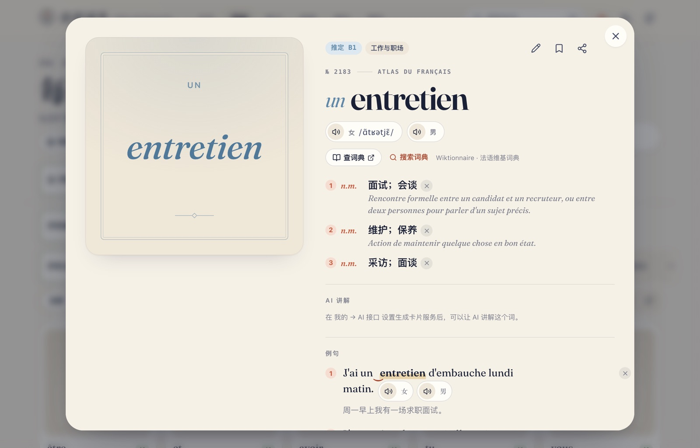
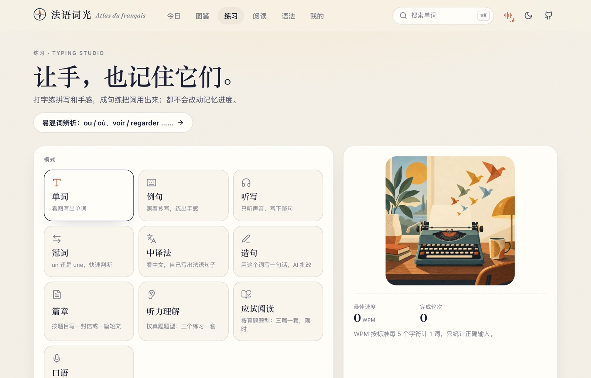
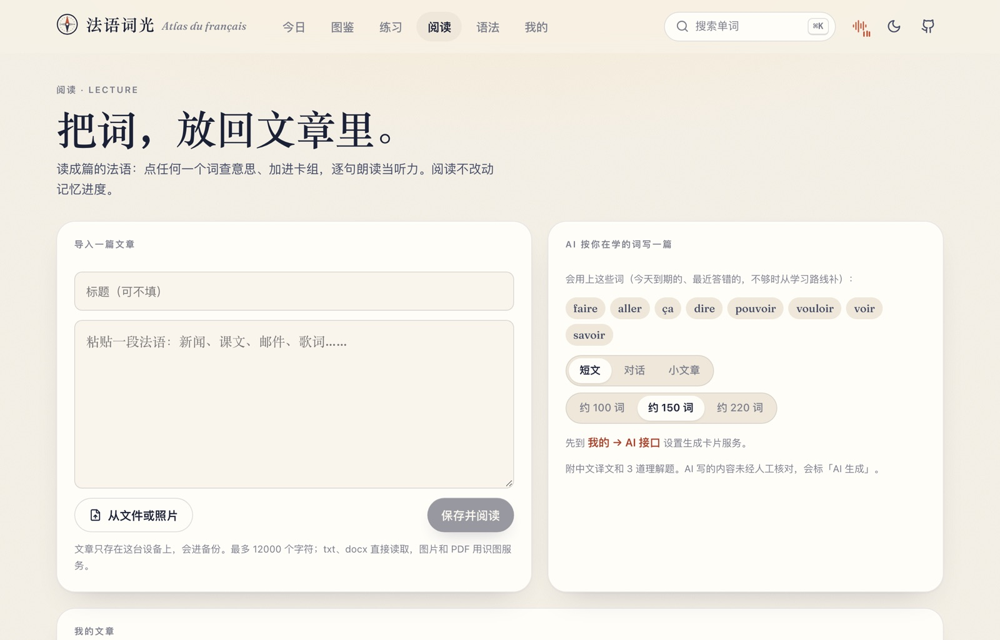
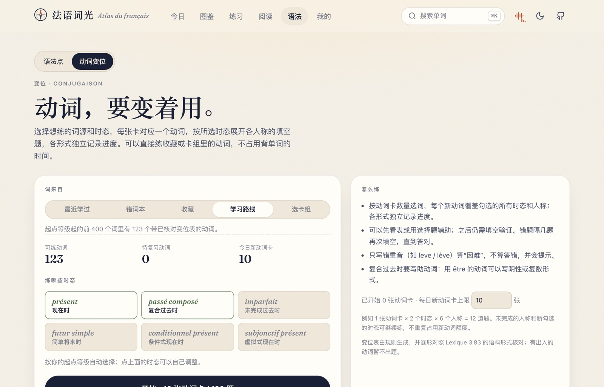

# 法语词光 · Mots B2

> 从零基础到 DELF B2 的法语背词与备考工具：7376 词的词库、离线词典、男女声朗读、FSRS 间隔复习，再加上 AI 出题和批改的 B2 四项专项练习。

以 [Word Atlas](https://github.com/designfuchen/word-atlas) 为原型改造的法语版本，打开网页就能用，也可以安装成 PWA。

**在线使用 →** [newsworld-niu.github.io/mots-b2](https://newsworld-niu.github.io/mots-b2/)


---

## ✨ 特点

### 📚 词库：来源可查，按词频排序

- **7376 个可学词条**，整理自 4 本法语词汇教材（A1 → B2/C1），每条都有中文释义和带中文翻译的例句（共 8207 句）。
- 等级分 **A1 / A2 / B1 / B2**，学习路线按 [Lexique 3.83](http://www.lexique.org/) 语料词频排列，**常用词先学**；开始时可以跳过已经会的低级别词。
- 名词标注阴阳性（un / une），并用 Lexique 逐条核对；有冲突的词不出题。
- 按 **16 个主题**（工作、经济、教育、健康、环境、媒体……）、词性、词族浏览，另有 **92 组易混词辨析**。

### 🔍 查词：在线 + 离线

- 首页查词接入 **法语助手**，同时内置 **离线词典**（Lexique + 法语维基词典 + Tatoeba 例句），没网也能查。
- 查到的词可以一键加入卡组；也可以从 **维基词典导入**释义和例句，保留来源链接。

### 🔊 发音：男女两种声音

- 单词和例句都有预先录好的 **女声 / 男声** 朗读（Azure 神经语音）。
- 没有录音的内容（自建词、AI 例句）可以接 Azure 实时朗读，或者用设备自带的法语语音。

### 🗂 卡片与卡组：随你组织

- 卡片上可以自己加 **例句、搭配、词族、注意点**，也可以让 **AI 一键补齐**。
- 自由 **新建卡组**，单词可以在卡组之间 **移动或复制**；也可以批量导入单词表。
- 粘贴一段法语（新闻、课文、歌词），或上传 **文件 / 照片**，自动抽出生词加入卡组。

### 🧠 学习与复习

- 用 **FSRS** 算法安排复习，目标记忆率可调（默认 90%）。
- 按 **卡组、词性、词族** 挑选学习范围。
- 多种题型：认词、听音选词、听写、拼写（连冠词）、un/une 快速判断、看图填词、中译法、用词造句（AI 批改）……
- **阅读模式**：AI 用你正在复习的词写短文；任意法语文本按「没学过 / 在学 / 已掌握」给词上色。
- 学习热力图、连续天数，还有可以分享的 **个人星图**。

### 📝 DELF B2 专项练习（AI 出题）

| 板块 | 内容 |
|---|---|
| **听力理解** | 按真题题型：两段长录音各听两遍、三段短录音各听一遍，一套 25 分，按考试的停顿时间作答 |
| **阅读理解** | 两篇报刊文章 + 一组「这是谁的观点」，整套限时 1 小时 |
| **书面表达** | 按题目写信或短文，AI 批改，可以交 **第二稿**、看 **范文**；写错的句子收进 **错句本**，还能看分数走势 |
| **口语表达** | 抽题 → 准备 30 分钟 → 独白 5–7 分钟 → **AI 扮考官辩论**，按官方评分表批改 |

### ✍️ 语法与变位

- **63 个语法点**（A1–B2）：每个点都有讲解、判断顺序、口诀、对比句、逐步拆解与速查表，配 **4674 道练习题**（选择、键入、改错、句型转换、语序），按规则和易错点统计掌握度，并把作文错句回流到对应语法点里练习。
- **1079 个动词** 的完整变位表：自写的规则引擎生成，每个形式都和 Lexique 语料比对过，对不上的动词不出题；选择题优先用按规则类推的常见假形作干扰项。专门的变位复习。

### 🎨 体验

- 浅色 / 深色 / 跟随系统；界面音效和 **环境声**（雨、海、森林、咖啡馆、壁炉……）。
- 学习数据存在本机浏览器，可以 **导出 / 导入备份**。
- 支持 PWA 安装，像本地应用一样使用。

---

## 🤖 AI 接口（可选）

不配置 AI 也能正常背词、查词、复习；AI 只用来出题、批改和补全卡片。在「**我的 → AI 接口**」里填写自己的 Key：

| 用途 | 可选服务 |
|---|---|
| 文本（出题、批改、补卡片） | DeepSeek（默认）· OpenAI · Anthropic · OpenRouter |
| 识图（从照片 / PDF 抽词） | OpenAI · Anthropic · OpenRouter |
| 生图（单词配图） | OpenAI · OpenRouter |
| 朗读 | Azure 语音 |

> [!NOTE]
> Key 只保存在你自己的浏览器里（localStorage），不会写进备份或云同步，也不会上传到任何服务器。本地运行时由开发服务器转发请求以解决跨域问题，转发时不记录内容。

---

## ☁️ 云同步（可选）

默认所有数据仅保存在本机。如配置了云同步服务端，可以在「**我的 → 云同步**」按需开启多设备同步：

- **邀请码开通与配对**：通过一次性**邀请码**创建个人**同步码**（`mb2_...`），在其他设备输入或扫码即可配对。请妥善保存同步码，**丢失后无法找回云端数据**。
- **同步范围**：单词记忆、卡组与自建词、自定义配图、作文与草稿、阅读文本、语法与变位记录、模考题库及学习设置（云端自动保留最近 20 个历史版本，可按版本恢复，也可随时一键删除云端数据）。
- **隐私与加密说明**：**AI 接口 Key 与 Azure 语音 Key 永远不会写进备份或上传到云端**；其余学习数据以**明文 JSON** 存储在作者的 Azure 存储上。

---

## 🖼 产品预览

| 图鉴 | 单词卡 |
|---|---|
|  |  |
| **练习** | **阅读** |
|  |  |
| **动词变位** | **深色模式** |
|  |  |

---

## 🚀 使用

### 网页

直接打开 [newsworld-niu.github.io/mots-b2](https://newsworld-niu.github.io/mots-b2/)。

### 本地运行

需要 Node.js 22+。

```bash
git clone https://github.com/Newsworld-niu/mots-b2.git
cd mots-b2
npm install
npm run dev        # http://127.0.0.1:5190
```

> [!TIP]
> 本地运行时法语助手查词和所有 AI 服务都通过开发服务器转发，比纯静态网页更稳定。

## 💬 发现 bug？

欢迎发起 issue 或者发邮件 **newsw0914@gmail.com**

## 🗺️ 待办清单

- [ ] 做一个法语单词数据库, 方便查询和添加单词
- [x] 支持云端备份, 避免设备切换时需要导出导入文件
- [ ] 增加更多模型支持: 可以添加自定义模型

---

## 📄 许可

- **代码**：[MIT](LICENSE)
- **内容**：教材来源的词头、页码与原例句版权归原作者和出版方，仅供个人学习；本项目补充的释义、例句、语法内容采用 CC BY 4.0；离线词典与词频数据来自 Lexique 3.83、Wiktionnaire、Tatoeba，按 CC BY-SA 4.0 使用。详见 [CONTENT_LICENSE.md](CONTENT_LICENSE.md)。

## 🙏 致谢

[Word Atlas](https://github.com/designfuchen/word-atlas) · [Lexique 3.83](http://www.lexique.org/) · [Wiktionnaire](https://fr.wiktionary.org/) / [kaikki.org](https://kaikki.org/) · [Tatoeba](https://tatoeba.org/) · [法语助手](https://www.frdic.com/) · [ts-fsrs](https://github.com/open-spaced-repetition/ts-fsrs)
